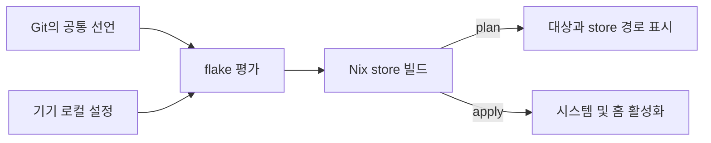

[](https://github.com/vanillacake369/tonys-nix/actions/workflows/ci.yml)
[](LICENSE)
[](https://nixos.wiki/wiki/Flakes)

# tonys-nix

NixOS, macOS(nix-darwin), WSL, 일반 Linux에서 사용할 개발 환경을 관리하는 공개 Nix
flake입니다. 공통 패키지와 설정은 Git에서 관리하고, 기기별 값은 기기 안에 둡니다.
비밀번호와 키는 이 저장소의 Nix 평가 입력으로 사용하지 않습니다.

## 왜 이렇게 나누나

여러 기기가 같은 도구와 설정을 쓰지만 로그인 사용자, 하드웨어, 회사 네트워크
조건은 다릅니다. 공개 가능한 선언만 Git에 올리고, 기기 전용 값은 저장소 밖의
명시적 경로에 둡니다. 공개 여부를 파일명 블랙리스트에 맡기지 않기 위한
구조입니다. 필수 프로필·호스트 대상·NixOS 하드웨어 설정이 없으면 임의의
기본값으로 적용하지 않고 중단합니다.

## 관리 범위

- NixOS, nix-darwin, WSL, Linux의 시스템 및 Home Manager 구성
- 셸, CLI, 언어 도구, Neovim, 키맵, 플랫폼별 앱

## 빠른 시작

`git`과 `just`가 필요합니다. 저장소 루트에서 로그인 사용자로 실행하세요.
시스템 적용이 필요한 단계에서만 명령이 직접 `sudo`를 요청합니다.

```bash
git clone https://github.com/vanillacake369/tonys-nix.git
cd tonys-nix
just
```

`just`는 플랫폼과 로그인 사용자 프로필을 확인한 뒤, 필요한 Nix 실행 환경을
준비하고 린트·가드 테스트를 통과하면 해당 플랫폼의 시스템 구성과 Home Manager를
적용합니다.
처음 실행하는 Mac에서 호스트 이름과 nix-darwin 구성 이름이 다르면 터미널에서
한 번 바인딩을 확인합니다. 비대화형 실행은 `DARWIN_CONFIG=tonys-mac just`로
구성 이름을 지정하세요.

기존 체크아웃에서 자주 쓰는 명령은 다음과 같습니다.

```bash
just                    # 사전 검사, 핵심 검사, 시스템과 홈 적용
just plan               # 활성화 없이 대상과 빌드 결과 확인
just apply home         # Home Manager만 적용
just check all          # 린트, 훅 테스트, flake 체크
nix fmt                 # Alejandra로 저장소의 Nix 파일 포맷
```

`just check lint`는 deadnix, statix와 flake의 포맷 검사를 실행하며 파일을
수정하지 않습니다. 포맷 설정은 `treefmt.nix` 한 곳에서 관리합니다.

로그인 이름(`id -un`)에 대응하는 `profiles/<profile>.nix`가 Git에 추적되어
있어야 합니다. `limjihoon` 로그인은 `profiles/personal.nix`를 사용하며 기존
`hm-limjihoon-*` 출력도 유지합니다. 새 로그인은 같은 이름의 프로필 파일을
추가하고 `username` 등을 수정한 뒤 `git add`하세요. 프로필 파일은 공개 Git
입력이므로 공개 가능한 값만 넣으세요.

적용 전에 빌드 결과를 보려면 Nix가 설치된 상태에서 `just plan`을 실행합니다.
Nix가 없다면 먼저 `just setup nix`로 설치할 수 있습니다. 이 명령은
`/etc/nix/nix.conf`를 준비하므로 시스템을 변경합니다.

## 구성의 소유권

`nodes/`는 기기의 시스템 진입점, `profiles/`는 사용자별 Home Manager 프로필,
`modules/`는 Home Manager와 NixOS 설정, `pkgs/`는 overlay를 담습니다.
공유 정책과 생성 함수는 `lib/`, 설정 원본은 `dotfiles/`, 검증과 실행 명령은
각각 `tests/`와 `recipes/`에 둡니다.
Home Manager 모듈은 `*.home.nix`, NixOS 모듈은 `*.nixos.nix` 이름으로
자동 탐색합니다. 구조 변경의 근거와 검증 순서는
[`docs/specs/flat-layout/`](docs/specs/flat-layout/design.md)에 기록했습니다.
프로필과 호스트 분리의 판단 근거는
[`docs/specs/profile-boundary/`](docs/specs/profile-boundary/assessment.md)에 기록했습니다.
선택적 Nix 도구 도입의 판단 근거는
[`docs/specs/nix-tooling/`](docs/specs/nix-tooling/assessment.md)에 기록했습니다.

| 위치 | 관리하는 내용 | Git 공개 여부 |
| --- | --- | --- |
| `flake.nix`, `modules/`, `pkgs/`, `nodes/*.nixos.nix`, `nodes/*.darwin.nix` | 공통 설정과 공유 가능한 호스트 구성 | 추적 |
| `profiles/<profile>.nix` | 이름이 지정된 Home Manager 프로필 | 추적 |
| `$XDG_CONFIG_HOME/tonys-nix/hosts/<LocalHostName>/` | 이 Mac의 구성 바인딩과 선택적 `darwin.nix` | 저장소 밖 |
| `/etc/nixos/hardware-configuration.nix` | 해당 NixOS 기기의 하드웨어 스캔 | 저장소 밖 |
| 비밀번호·토큰·개인키 | 저장소 밖의 별도 자격증명 위치 | 이 flake에 입력하지 않음 |

공개 Git이 이 저장소의 공통 선언 원본입니다. 기기 로컬 파일은 그 기기에만
적용할 값이며, Nix store 경로와 활성화된 시스템·홈 세대는 평가·빌드·적용
결과입니다. `darwin.nix`를 Git에서 제외했다는 사실만으로 내용이 비밀이
되지는 않습니다. 평가된 값은 Nix store에 나타날 수 있습니다.



AI Provider 설정은 별도의 [Tony's Agent Harness](https://github.com/vanillacake369/tonys-agent-harness)에서
관리합니다. 이 저장소는 그 Vault나 Provider 연결을 만들거나 배포하지
않습니다.

## `plan`과 `apply`

| 명령 | 동작 | 시스템·홈 활성화 |
| --- | --- | --- |
| `just plan [all\|home\|system] [profile]` | 대상 확인 후 선택한 출력을 빌드하고 store 경로 표시 | 없음 |
| `just apply [all\|home\|system] [profile]` | 선택한 시스템 및 홈 구성 적용 | 있음 |
| `just` | 사전 검사 → 실행 환경 준비 → 린트·가드 테스트 → `apply all` | 있음 |
| `just check all` | 린트, 훅 테스트, flake 체크 | 없음 |
| `just check core` | Nix·`nix.conf`·Home Manager 실행 환경 준비 후 빠른 검사 | 없음 |

기본 프로필은 `id -un`입니다. `plan system`과 `apply system`에는 프로필을
지정하지 않습니다. macOS의 시스템 대상은 `darwinConfigurations.<config>`,
홈 대상은 `homeConfigurations.hm-<profile>-aarch64-darwin` 형태입니다.

`plan`은 `sudo`, macOS 호스트 바인딩 저장, 시스템 활성화, Home Manager
활성화를 실행하지 않습니다. 빌드 과정에서 Nix store와 캐시가 채워질 수
있습니다. 결과는 **대상과 빌드 가능 여부**를 보여주며 Terraform처럼
시스템 리소스별 변경 내역을 계산하지 않습니다. 실제 적용 시 시스템과 홈은
별도 단계이므로 홈 적용이 실패하면 앞선 시스템 적용은 유지될 수 있습니다.
`check core`는 활성화하지 않지만 Nix 설치나 `/etc/nix/nix.conf` 준비로
시스템 파일을 변경할 수 있습니다.

## macOS 호스트와 기기 로컬 설정

`nodes/tonys-mac.darwin.nix`는 공유할 Homebrew 앱과 시스템 기본값을 선언합니다.
`just`는 명시한 `DARWIN_CONFIG`, 저장된 `config-name` 바인딩, macOS
`LocalHostName`과 일치하는 구성 순서로 선택합니다. 바인딩이 없고 선언된
구성이 하나뿐이면 대화형 적용에서 한 번 확인하며, 여러 구성이 있으면
`DARWIN_CONFIG=<name>`을 명시해야 합니다. 바인딩 전 `plan`도 명시한
구성 이름이 필요합니다. 잘못되거나 오래된 바인딩은 적용하지 않고 오류로
중단합니다.

바인딩은 기본적으로
`~/.config/tonys-nix/hosts/<LocalHostName>/config-name`에 저장됩니다.
`XDG_CONFIG_HOME`이 설정돼 있으면 그 아래에 저장합니다. 바인딩 디렉터리는
`0700`, 파일은 `0600`으로 생성됩니다. `DARWIN_CONFIG`를 지정한 **적용**은
바인딩을 갱신하지만 `plan`은 갱신하지 않습니다.

같은 디렉터리의 선택적 `darwin.nix`는 기기별 **비밀이 아닌** nix-darwin
옵션용입니다. 회사 네트워크의 특정 로컬 주소가 macOS Local Network
Privacy(LNP)에 막히는 경우, Apple이 문서화한 시스템 기본값을 이 기기에만
선언할 수 있습니다. `<승인된-로컬-CIDR>`는 실제 승인된 IPv4/IPv6 CIDR로
바꿔야 합니다.

```nix
{
  system.defaults.CustomSystemPreferences."com.apple.network.local-network" = {
    AllowedWiFiLocalNetworkAddresses = ["<승인된-로컬-CIDR>"];
    AllowedEthernetLocalNetworkAddresses = ["<승인된-로컬-CIDR>"];
  };
}
```

이 값은 지정한 네트워크 주소를 LNP 검사에서 로컬 주소로 취급하지 않게 하므로
**모든 앱**에 영향을 줍니다. 필요한 주소만 좁게 지정하세요. 일반적인 인터넷
outbound, DNS, 프록시, 방화벽 설정을 대신하지 않습니다. Apple 문서에 따르면
변경 후 재시작해야 효과가 적용됩니다.
[Apple TN3179: Understanding local network privacy](https://developer.apple.com/documentation/technotes/tn3179-understanding-local-network-privacy)

새 Mac에서 로컬 모듈을 준비하고 미리 확인하려면 다음 순서로 진행합니다.

```bash
local_host="$(scutil --get LocalHostName)"
local_dir="${XDG_CONFIG_HOME:-$HOME/.config}/tonys-nix/hosts/$local_host"
mkdir -p "$local_dir"
chmod 700 "$local_dir"
vi "$local_dir/darwin.nix"  # 위 예시를 입력하고 CIDR을 교체
chmod 600 "$local_dir/darwin.nix"
DARWIN_CONFIG=tonys-mac just plan system
DARWIN_CONFIG=tonys-mac just apply system
```

`plan`은 바인딩을 만들지 않으며, 마지막 적용 명령이 바인딩을 저장합니다.
`just`는 로컬 모듈을 nix-darwin에 전달하고, 순수 flake 체크에서는 로컬
모듈을 생략합니다. 다른 공유 구성을 추가한다면 `nodes/<name>.darwin.nix`와
`flake.nix`의 `darwinConfigurations` 출력, 로컬 모듈 연결 조건을 함께
추가하세요.

시스템 활성화는 `sudo` 암호를 요청할 수 있습니다. `just`는 로그인 사용자를
nix-darwin의 Homebrew 적용 단계에 전달하고, Home Manager는 그 사용자로
실행합니다. Homebrew 적용은 없는 항목을 설치하며 관리하지 않는 앱을
삭제하거나 기존 formula·cask를 자동 업그레이드하지 않습니다.

```bash
just sync brew
```

첫 적용에는 flake에 고정된 nix-darwin `darwin-rebuild` 앱을 사용합니다.

## NixOS 하드웨어

NixOS의 기본 `just`, `plan system`, `apply system`은 실제 기기의
`/etc/nixos/hardware-configuration.nix`가 읽을 수 있는 파일인지 확인합니다.
파일이 없으면 자동으로 생성하거나 예시 디스크 설정으로 적용하지 않습니다.
대상 기기에서 생성·검토한 후 실행하세요.

```bash
sudo nixos-generate-config --show-hardware-config |
  sudo tee /etc/nixos/hardware-configuration.nix >/dev/null
just plan system
just
```

NixOS 시스템 출력 이름은 현재 `hostname`과 일치해야 합니다. 현재 flake의
출력은 `nixosConfigurations.tony`입니다. 새 NixOS 호스트를 추가할 때는
해당 출력을 먼저 선언하세요. macOS·CI에서 flake를 평가하기 위한 하드웨어
대체값은 실제 NixOS 적용 경로에서 사용할 수 없습니다.

## 다른 명령

```bash
just apply home [profile]              # 홈 구성만 적용
just setup <all|nix|home|mac|completions>
just maintenance gc [auto|force|status]
just image list
just image build <format>
just image build-arch <format> <arch>
```

Fish 자동완성은 Home Manager로 설치됩니다. 저장소 전용 하위 명령 제안은
이 저장소의 Git 루트 안에서만 활성화됩니다.

## Raycast

Raycast 명령은 지원되는 GUI 내보내기·가져오기 순서와 확인 방법만 안내합니다.
파일을 자동 전송하거나 가져오기 완료를 주장하지 않습니다.

```bash
just sync raycast export  # GUI 내보내기 안내
just sync raycast import  # GUI 가져오기 안내
just sync raycast verify  # 가져오기 확인 안내
```

`.rayconfig` 파일과 암호는 Git에 올리지 마세요. 가져오기는 Raycast 안에서
확인해야 하며 대상 Mac의 설정과 병합됩니다.

## 검증과 설계 참고

변경 제출 전 다음 명령을 실행하세요.

```bash
just check all
```

Home Manager는 빌드와 활성화를 구분하며, 빌드 단계에서 옵션 타입과 일부
선언 오류를 확인합니다.
[Home Manager 사용 설명서](https://github.com/nix-community/home-manager/blob/master/docs/manual/usage.md)

구성 위치와 공개 범위를 정할 때 공개 저장소의 호스트별 선언과 로컬 파일
분리 사례를 참고했습니다:
[gapul/dotfiles](https://github.com/gapul/dotfiles/blob/main/README.md),
[nipuna-g/dotfiles](https://github.com/nipuna-g/dotfiles/blob/master/README.md).
이 저장소는 별도의 암호화 저장소나 비밀 주입 기능을 제공하지 않습니다.

## License

[MIT](LICENSE)
