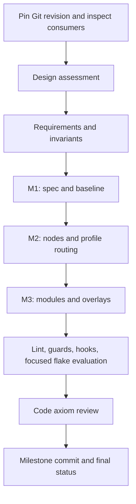

# Flat layout milestone plan

## Capability and decision DAG

| Stage | Tool or skill | Input and evidence | Failure branch |
| --- | --- | --- | --- |
| Source pin | `git status`, `git rev-parse`, `rg` | Clean revision, direct path consumers, lockfile diff | Resolve dirty scope before edits |
| Architecture | `skl-pre-design-assessment-ljh` | AS-IS, current versus flat options, migration/rollback | Retain AS-IS if benefits do not justify migration |
| Nix evidence | `tool-nix-ljh` via `nix eval --offline --no-update-lock-file` | Output names, identities, platform options, derivation paths | Inspect expression and source availability; do not silently update lock |
| Milestone gate | `skl-mid-milestone-cycle-ljh` via `just` and Git | Guard, Bats, lint, build results at each phase | Refine the same milestone |
| Invariant gate | `skl-mid-code-axiom-ljh` | Code, direct tests, evaluated behavior, exceptions | Mark UNKNOWN or NOT_RUN and leave work uncommitted if acceptance depends on it |
| Final audit | `git diff --check`, `git diff -- flake.lock`, `git status` | No whitespace, no lock drift, committed tree | Correct drift before final status |

The DAG is sequential because each next stage consumes a stable previous revision.
Independent lint and evaluation probes may run concurrently inside a gate. No agent
delegation or remote mutation is needed.

## M1: Spec and baseline

Prerequisite: clean `afe2c93e` worktree. Deliver this spec, source mapping, and
baseline guard/Just evidence. Gate: spec names all path-sensitive consumers and
the baseline focused evaluations pass. Commit: `docs: specify flat Nix layout`.

## M2: Node ownership and public routing

Move user and machine entrypoints to `nodes/`, update flake and Just/Fish paths,
and keep historical output keys. Gate: node/profile guard tests, Just UX tests,
and focused output evaluation pass. Commit: `refactor: move Nix entrypoints to nodes`.

## M3: Flat modules and overlays

Move Home Manager and NixOS modules to the `modules/` root and overlays to `pkgs/`;
move shared policy and keymap helpers to `lib/`/`dotfiles/`; update discovery,
tests, recipes, and README. Gate: lint, all guard tests, Just hook tests, focused
home/Darwin/NixOS evaluations, and code-axiom table pass. Commit:
`refactor: flatten Nix modules and overlays`.

## Code axiom gate

For each milestone record `invariant | code evidence | observed behavior |
static/manual check | exception | risk | decision | validation state | next action`.
Prioritize output and activation correctness over formatting. No extra abstraction
is added solely to satisfy the new directory shape.
