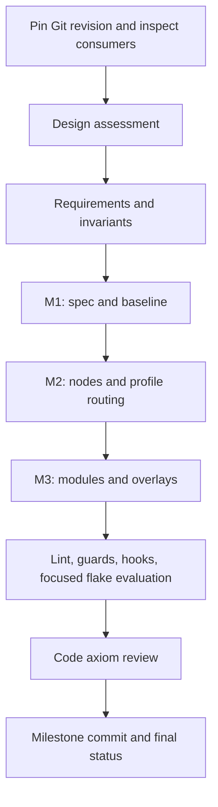

# Flat layout milestone plan

## Capability and decision DAG

Tool routing: `git`/`rg` for source identity and consumers; `nix eval` with
`--no-update-lock-file` for output evidence; `just` for project checks. The design
assessment skill owns option choice, milestone-cycle skill owns gates, and code-axiom
skill owns explicit invariant review. A failed gate returns to the same milestone.
No agent delegation or remote mutation is needed.

## M1: Spec and baseline

Prerequisite: clean `afe2c93e` worktree. Deliver this spec, source mapping, and
baseline guard/Just evidence. Gate: spec names all path-sensitive consumers and
the baseline focused evaluations pass. Commit: `docs: specify flat Nix layout`.

## M2: Node ownership and public routing

Move user and machine entrypoints to `nodes/`, update flake and Just/Fish paths,
and keep historical output keys. Gate: node/profile guard tests, Just UX tests,
and focused output evaluation pass. Commit: `refactor: move Nix entrypoints to nodes`.

## M3: Flat modules and overlays

Move Home Manager and NixOS modules to the `modules/` root and overlays to `pkgs/`;
move shared policy and keymap helpers to `lib/`/`dotfiles/`; update discovery,
tests, recipes, and README. Gate: lint, all guard tests, Just hook tests, focused
home/Darwin/NixOS evaluations, and code-axiom table pass. Commit:
`refactor: flatten Nix modules and overlays`.

## Code axiom gate

For each milestone record `invariant | code evidence | observed behavior |
static/manual check | exception | risk | decision | validation state | next action`.
Prioritize output and activation correctness over formatting. No extra abstraction
is added solely to satisfy the new directory shape.
